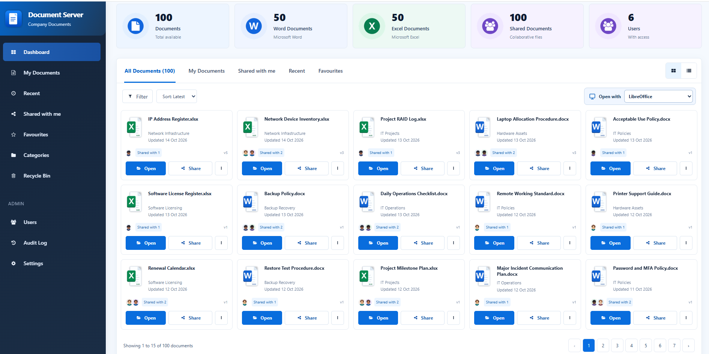

# Document Server

**A modern company document management system built with Laravel 13, Inertia.js and Vue 3.**

Document Server provides a central place for teams to organise documents, find files, share access, track document revisions and open supported Office documents using a configured desktop integration.



> **Screenshot:** `public/images/screenshot.png`. The example shown contains sample documents and users; counts and content will vary between installations.

## Contents

- [Features](#features)
- [Technology](#technology)
- [System requirements](#system-requirements)
- [Installation and first run](#installation-and-first-run)
- [Using Document Server](#using-document-server)
- [Document version control](#document-version-control)
- [Administrator guide](#administrator-guide)
- [Development and quality checks](#development-and-quality-checks)
- [Source-code version control with Git](#source-code-version-control-with-git)
- [Deployment and security](#deployment-and-security)
- [Troubleshooting](#troubleshooting)

## Features

| Area | Description |
| --- | --- |
| Dashboard | Summary cards for documents, Word files, Excel files, shared files and users. |
| Document browser | Browse documents in a card grid or list; use tabs, filters, sorting and pagination. |
| Personal documents | View your documents separately from the full document collection. |
| Sharing | View shared documents and use each document's **Share** action to manage collaboration where permitted. |
| Recent & favourites | Return to recently used files and keep frequently accessed documents handy. |
| Categories | Browse documents grouped by category. |
| Document versions | See version labels such as **v1**, **v2** and **v5** on document cards. |
| Office integration | Choose an available **Open with** option, including **LibreOffice** in the pictured setup. |
| Recycle Bin | Access the area for deleted documents and any recovery actions exposed by your installation. |
| Administration | Dedicated **Users**, **Audit Log** and **Settings** navigation for authorised accounts. |

> Some commands and menu items depend on your account permissions and which integrations have been configured. This guide describes the visible navigation and expected workflows; it does not assume that every possible action, such as restoring an old revision, is implemented.

## Technology

- **Backend:** PHP, Laravel 13
- **Frontend:** Vue 3, TypeScript, Inertia.js
- **Assets and tooling:** Vite 8, Vite Plus (`vp`), Tailwind CSS 4
- **Authentication:** Laravel starter-kit authentication
- **Routes in the frontend:** Laravel Wayfinder
- **Database:** Configured through Laravel's `.env` file (for example, SQLite or a supported SQL server)
- **Documents:** Laravel-managed file storage, document metadata and recorded revisions
- **Optional desktop document integration:** WebDAV-based document access and LibreOffice support, where configured

## System requirements

For a development environment, install:

- PHP **8.3 or newer**, with the extensions required by Laravel and this project's Composer dependencies
- Composer 2
- Node.js **20.19+ or 22.12+** (a compatible current LTS release is recommended) and npm
- A supported database, or SQLite for a simple local setup
- Git (recommended)
- LibreOffice on the workstation **only if you intend to use that desktop opening/editing option**

The exact PHP extension and database requirements are determined by the checked-in `composer.json` / `composer.lock` and your selected database driver.

## Installation and first run

These examples use **Windows PowerShell** from the project root. On Linux or macOS, use the equivalent shell commands.

### 1. Get the project

Clone your repository, or use your existing local checkout, then move into the project directory:

```powershell
cd E:\doc-server
```

### 2. Install dependencies

```powershell
composer install
npm ci
```

If the repository does not include a `package-lock.json`, use `npm install` instead of `npm ci`.

### 3. Create the environment configuration

For a fresh installation:

```powershell
Copy-Item .env.example .env
php artisan key:generate
```

If you already have a configured `.env`, **keep it**; do not overwrite it.

Set `APP_NAME`, `APP_URL`, your mail settings (if needed), and the appropriate `DB_*` variables in `.env`. Never commit `.env` or production passwords to Git.

#### Example: local SQLite database

Create the file if it does not already exist:

```powershell
if (-not (Test-Path database/database.sqlite)) {
    New-Item -ItemType File -Path database/database.sqlite | Out-Null
}
```

In `.env` set:

```dotenv
DB_CONNECTION=sqlite
```

For MySQL, PostgreSQL or another configured database, use that database's connection settings instead.

### 4. Create the database tables

```powershell
php artisan migrate
```

**Optional sample data for a local development environment only:**

```powershell
php artisan db:seed --class=DocumentServerDemoSeeder
```

This project includes a demo seeder. Review what it creates before running it, and **do not seed demonstration users or documents on production**.

### 5. Generate frontend route helpers

The Vue pages use Wayfinder form helpers, so generate those with the form option:

```powershell
php artisan wayfinder:generate --with-form
```

The Vite Wayfinder plugin should also be configured to preserve the form variants during development and builds.

### 6. Start the application

**Terminal 1 — Laravel:**

```powershell
php artisan serve
```

**Terminal 2 — frontend assets:**

```powershell
npm run dev
```

Visit **http://127.0.0.1:8000** unless your application is configured to use another URL or port.

Sign in with an account created through the application's registration/administration workflow. A new installation will need an account with the appropriate access rights before administration pages can be used.

## Using Document Server

### 1. Sign in and understand the dashboard

After signing in, use the left-hand navigation to move between **Dashboard**, **My Documents**, **Recent**, **Shared with me**, **Favourites**, **Categories** and **Recycle Bin**.

The five summary cards show the current counts for:

1. All documents
2. Word documents
3. Excel documents
4. Shared documents
5. Users

These are live figures for your installation, not fixed limits. The screenshot happens to show **100 documents**, **50 Word documents**, **50 Excel documents**, **100 shared documents** and **6 users**.

### 2. Find a document

From the Dashboard, choose one of the document tabs:

- **All Documents:** browse the collection you have permission to see.
- **My Documents:** focus on documents belonging to you.
- **Shared with me:** find documents other people have shared with you.
- **Recent:** return to recently accessed documents.
- **Favourites:** find documents you've marked as favourites.

Use **Filter** to narrow the selection, **Sort** (shown as *Latest* in the screenshot) to change ordering, and the **grid/list** controls at the top right to change the view. Pagination at the bottom moves through additional results.

Each document card displays the file name, related category, update date, sharing information and its current version label. The card also provides **Open**, **Share** and a **three-dot (`⋮`) menu** for more actions.

### 3. Add and organise documents

1. Open **My Documents**, or the document area in which you are permitted to add files.
2. Use the available **Upload** or **Add document** action in your installation.
3. Select a supported file, complete any requested title/category details and submit it.
4. Return to the document list to confirm the file appears with the expected title and category.
5. Use **Categories** to browse the file within its group.

> The dashboard screenshot does not show the upload form. Button wording, file-size limits and accepted file formats should be checked against the installed upload screen and server validation rules.

### 4. Open a Word or Excel document

1. Find the document in the list.
2. Check the **Open with** selector above the document cards. The pictured installation shows **LibreOffice**.
3. Choose the available integration you want to use.
4. Click **Open** on the document card.
5. Follow any browser or desktop-application prompt to open the file.
6. If editing is permitted, save your work and return to Document Server to confirm the changes have been recorded.

For LibreOffice opening/editing, the workstation must have a compatible installation and the server-side opening/WebDAV workflow must be configured and reachable. Browser security prompts or operating-system application associations may affect launching.

**Do not assume an edit has been saved to the server just because the desktop editor closed.** Check the document's updated date and version where applicable, or reopen it to verify.

### 5. Share documents with colleagues

1. Locate the document and select **Share**.
2. Choose the colleague or colleagues you are permitted to share with.
3. Set any available sharing permission options.
4. Confirm the share operation.
5. Use **Shared with me**, the document's share information, or the available sharing management controls to verify access.

The small *Shared with 1* / *Shared with 2* labels shown on cards indicate sharing information. Access is still subject to server-side permissions. Only share documents with people authorised to see their contents.

### 6. Use Recent and Favourites

Open **Recent** to revisit documents you've accessed. To keep a frequently used document close at hand, use its available favourite action (usually within the document menu), then open **Favourites** to find it again. Use the same action or available menu option to remove it from favourites.

### 7. Browse Categories

Select **Categories** in the sidebar to browse documents by category. Category creation, editing and deletion depend on the permissions granted to the signed-in user.

### 8. Use the Recycle Bin

Deleted documents are managed through **Recycle Bin**. Open it to inspect any files shown there; if your installed version exposes **Restore** or permanent-deletion commands, use them only after confirming you have selected the correct document.

Permanent deletion can be irreversible. It should be covered by backups and a defined retention policy.

## Document version control

**Document versioning** is separate from Git version control of the application itself.

Document cards display version labels such as `v1`, `v3` and `v5`. These are document revisions, not the Laravel application version.

| Example | Meaning |
| --- | --- |
| `v1` | The document's first recorded version. |
| `v2` | A later recorded revision. |
| `v5` | The document has reached its fifth recorded version. |

### How to work safely with document revisions

1. **Open** the document you are permitted to edit.
2. Make your changes using the configured editor or supported update workflow.
3. Save the document using that workflow.
4. Return to the document list and check its current version label and update date.
5. Reopen the document if necessary to confirm the latest contents were saved.

The backend has document-version and revision handling. However, **the screenshot alone does not establish whether the UI exposes a complete version-history browser, rollback, revision comparison, or download of historical versions**. Do not promise those operations to users until they have been tested in the installed build.

For reliable revision tracking, administrators should verify that the system retains the correct prior file contents, records who made each change where implemented, and respects document permissions when historical revisions are accessed.

## Administrator guide

The sidebar shows an **ADMIN** area containing **Users**, **Audit Log** and **Settings**. These pages should only be available to authorised accounts.

### Users

Use **Users** to review accounts and the access-management actions available in your installation. Apply the least-privilege principle: grant people only the permissions they need, and review access when someone changes role or leaves the organisation.

### Audit Log

Use **Audit Log** to investigate recorded document and account activity. Available event types, filters and retention depend on the application's configured auditing features. Audit entries should be treated as security-relevant data.

### Settings

Use **Settings** for the preferences and administrative configuration your account is allowed to change. Test any integration or storage changes before rolling them out to users.

## Development and quality checks

From the project root, use the existing commands:

| Command | Purpose |
| --- | --- |
| `npm run dev` | Start Vite Plus in development mode. |
| `npm run build` | Build production frontend assets. |
| `npm run check` | Check frontend formatting and lint rules without applying fixes. |
| `npm run check:fix` | Apply supported frontend formatting/lint fixes. |
| `npm run types:check` | Type-check Vue/TypeScript without emitting files. |
| `vendor\bin\pint --test` | Check PHP formatting on Windows. |
| `vendor\bin\pint` | Apply PHP formatting fixes on Windows. |
| `php artisan test` | Run Laravel automated tests. |
| `composer ci:check` | Run the checks currently configured in `composer.json`. |

A typical local verification sequence is:

```powershell
npm run check:fix
vendor\bin\pint
npm run types:check
php artisan test
composer ci:check
```

**Note:** `composer ci:check` executes the scripts currently registered in `composer.json`. If it still includes PHPStan or other tools, they will still run; review that file rather than assuming a particular CI configuration. Tests and static checks help catch problems but do not replace browser testing of sharing, document revision saving, permissions and desktop integration.

### After changing routes

The frontend uses generated Wayfinder route helpers. If PHP routes change, regenerate them using:

```powershell
php artisan route:clear
php artisan wayfinder:generate --with-form
npm run types:check
```

Avoid manually editing generated TypeScript under `resources/js/actions/` or `resources/js/routes/`; those files may be overwritten during generation.

## Source-code version control with Git

Use **Git** for changes to the Document Server application, and **document versions** for changes to files stored *inside* the application.

### Recommended workflow

1. Create a branch for a feature or fix.
2. Make your change, and add or update automated tests.
3. Run formatting, TypeScript and application tests.
4. Review the diff and commit the change.
5. Push the branch and review GitHub Actions before merging.
6. Create release tags only for builds that have been tested and approved.

Example commands:

```powershell
git switch -c feature/document-improvements
# Make changes and test them
git status
git diff
git add .
git commit -m "Improve document management workflow"
git push -u origin feature/document-improvements
```

An **example** release tag, once a build is ready for release:

```powershell
git tag -a v1.0.0 -m "Document Server v1.0.0"
git push origin v1.0.0
```

`v1.0.0` is illustrative; it **does not claim this project has already released that version**. Keep a changelog for significant application releases, use semantic version numbers where appropriate, and never include document uploads, secrets or private storage files in Git.

### Updating this README's screenshot

Replace `public/images/screenshot.png` with an updated screenshot **using the same filename**, then commit the image and `README.md` together. GitHub displays the image through the relative link at the top of this file.

## Deployment and security

Before a production deployment:

- Set `APP_ENV=production` and `APP_DEBUG=false`.
- Configure `APP_URL`, HTTPS, email and the production database.
- Point the web server at Laravel's **`public/`** directory, not the repository root.
- Keep `.env`, uploaded documents, private revision files and backup archives outside publicly accessible paths.
- Configure appropriate file/directory permissions and backup both **database records and stored document contents**.
- Protect sharing and WebDAV/standalone access with appropriate authentication, authorisation, expiring credentials or tokens as implemented, and HTTPS.
- Do not run demo seeders in production.
- Run database migrations and deploy compiled frontend assets as part of a reviewed release process.
- Test file upload, opening, saving, revision retention, account permissions and document recovery before inviting real users.

A basic production asset build is:

```powershell
npm ci
npm run build
```

Use your server's approved deployment procedure for Composer dependencies, migrations, configuration caching, queues and web-server setup. Do not use `php artisan serve` as your production web server.

## Troubleshooting

| Problem | What to check |
| --- | --- |
| Application will not load | Confirm Laravel is running, the configured `APP_URL` is correct and the chosen port is accessible. |
| Blank page or missing styling | Start `npm run dev` locally, or rebuild production assets with `npm run build`. |
| Login or database errors | Check `.env`, the configured database connection and migrations. |
| Generated TypeScript route errors | Regenerate Wayfinder routes with `--with-form`; check any custom HTTP methods against the installed Wayfinder version. |
| `*.form()` not found | Confirm Wayfinder form variants are generated and enabled in the existing Vite configuration. |
| PHP formatting check fails | Run `vendor\bin\pint` and rerun the check. |
| Frontend formatting check fails | Run `npm run check:fix`, then verify the changes. |
| LibreOffice does not open | Check workstation installation, browser prompts and the server's desktop/WebDAV integration configuration. |
| Saved changes do not appear | Confirm the document was successfully saved through the integration, then refresh and verify its content/version. |
| User cannot see a document | Review its ownership, sharing and applicable access permissions. |

## Further reading

- [Laravel 13 documentation](https://laravel.com/docs/13.x)
- [Vue 3 documentation](https://vuejs.org/)
- [Inertia.js documentation](https://inertiajs.com/)
- [Laravel Wayfinder](https://github.com/laravel/wayfinder)
- [Vite documentation](https://vite.dev/)

---

**Document Server** — a central workspace for company documents, collaboration and version-aware document management.
